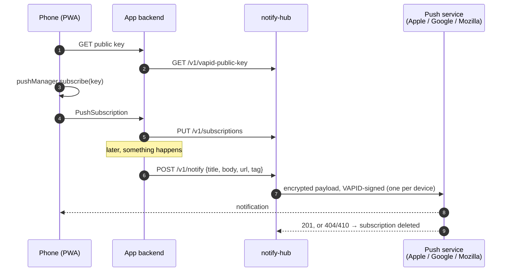
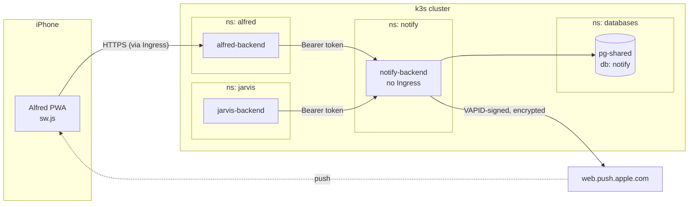
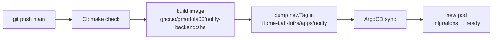

# notify-hub

[](https://github.com/gmottola00/Notify-Hub/actions/workflows/ci.yml)


[](LICENSE)

**A small, self-hosted [Web Push](https://www.rfc-editor.org/rfc/rfc8030) hub for a home lab.**
It holds the VAPID key and every app's subscribed devices, and delivers notifications
to Apple, Google and Mozilla push services. Your apps just say *"send this"*.

```bash
curl -X POST http://notify:8000/v1/notify \
  -H "Authorization: Bearer $NOTIFY_TOKEN" \
  -d '{"title": "Budget at 80%", "body": "Groceries: €320 of €400", "url": "/budget", "tag": "budget:groceries"}'
# → {"sent": 2, "failed": 0, "removed": 0}
```

## Why

Push notifications on a phone (including an iPhone, through a PWA added to the Home Screen) need
the same plumbing in every app: a VAPID key pair, a table of subscriptions, encryption of the
payload ([RFC 8291](https://www.rfc-editor.org/rfc/rfc8291)), signed requests to the push services,
and cleanup of the devices that went away. notify-hub does that once, for every app in the lab.

The split of responsibilities is the whole point:

- **The app decides _what_ to say and _when_** (budget at 80%, a double charge, a job that failed).
- **The hub only knows _who_ to deliver it to and _how_.**

Apps never talk to the phone, and never touch a private key.

## How it works



- **The token is the app.** Every call under `/v1` carries `Authorization: Bearer <token>`. The hub
  knows only the SHA-256 of each token (`NOTIFY_APPS`) and compares in constant time. The app is
  decided by the token, never by the request body, so one app can neither read nor remove another
  app's devices.
- **One VAPID key for every app.** Push services only check that the JWT signature matches the
  public key the browser subscribed with; they don't care about the app's domain. **Rotating the key
  invalidates every subscription**: every phone has to enable notifications again.
- **Fan-out with a cap.** `/v1/notify` sends to all the app's devices concurrently (at most
  `NOTIFY_SEND_CONCURRENCY` at a time) and reports what happened per device.
- **Self-cleaning.** A `404` or `410` from the push service (app removed, permission revoked) deletes
  the subscription. Any other error increments `failures`, which resets to 0 on the next success.
- **`tag` collapses.** On the phone it replaces an earlier notification with the same tag; towards the
  push service it becomes the `Topic` header, so ten identical alerts sent while the phone is off
  arrive as one.
- **Zero devices is not an error:** `{"sent": 0}`.

## Quick start

Requires [uv](https://docs.astral.sh/uv/).

```bash
make setup   # uv sync + .env with a dev VAPID key and a token for "my-app"
make run     # hub on :8300, SQLite in ./notify.db
make check   # black, isort, ruff, mypy --strict, pytest (+ doctests)
```

The token for `my-app` is in a comment at the bottom of `.env`. More apps:
`make dev-keys APPS="app1 app2"` prints a fresh key and a token per app.

Or with Docker, no Kubernetes needed:

```bash
make setup
docker compose up -d   # hub on :8300, SQLite in a volume
```

Interactive API docs at `http://localhost:8300/docs`.

## API

| Method | Path | What it does |
|---|---|---|
| `GET` | `/health` | Probe; touches neither the database nor the push services |
| `GET` | `/v1/vapid-public-key` | `{key}`, to pass to `pushManager.subscribe` as `applicationServerKey` |
| `PUT` | `/v1/subscriptions` | `PushSubscription.toJSON()` plus an optional `label`. Idempotent per endpoint |
| `DELETE` | `/v1/subscriptions` | `{endpoint}`. Idempotent |
| `GET` | `/v1/subscriptions` | The app's devices, with last success and consecutive failures |
| `POST` | `/v1/notify` | `{title, body?, url?, tag?, ttl?, urgency?}` → `{sent, failed, removed}` |

The phone receives `{title, body?, url?, tag?}`. `url` is a path inside the app (`/budget`),
opened when the notification is tapped. `ttl` (seconds, default 1 day) is how long the push
service keeps the message for a phone that is offline; `urgency` is `very-low`, `low`,
`normal` or `high`.

## Configuration

Everything is read from the environment (or `.env`), prefix `NOTIFY_`. See [`.env.example`](.env.example).

| Variable | Default | |
|---|---|---|
| `NOTIFY_VAPID_PRIVATE_KEY` | — | EC P-256 private key, PEM. **Required** |
| `NOTIFY_VAPID_SUBJECT` | `mailto:admin@example.com` | `mailto:you@domain` or a bare `https://host`. Validated at boot; Apple rejects placeholders and `localhost` |
| `NOTIFY_APPS` | `{}` | JSON: app name → SHA-256 hex of its token |
| `NOTIFY_DATABASE_URL` | `sqlite+aiosqlite:///./notify.db` | Any SQLAlchemy async URL; also read from `DATABASE_URL`. Postgres: `postgresql+psycopg://…` |
| `NOTIFY_DEFAULT_TTL` | `86400` | Seconds |
| `NOTIFY_SEND_CONCURRENCY` | `10` | Pushes in flight per notify call |
| `NOTIFY_LOG_LEVEL` / `NOTIFY_LOG_JSON` | `INFO` / `false` | structlog, JSON in the cluster |

Alembic migrations run at startup, before `/health` answers: a broken key or a failed
migration means the container never becomes ready.

## Wiring up an app

The browser never talks to the hub: the hub has no public URL, and the token must stay on the
server. The app's backend exposes three tiny endpoints that proxy to the hub
(public key, `PUT` and `DELETE` subscription) and calls `/v1/notify` whenever it has something to say.

**In the page** — must run inside a click handler, or Safari refuses the permission prompt:

```js
async function enablePush() {
  if ((await Notification.requestPermission()) !== "granted") return;
  const reg = await navigator.serviceWorker.ready;
  const { key } = await fetch("/api/push/key").then((r) => r.json());
  const sub = await reg.pushManager.subscribe({
    userVisibleOnly: true,
    applicationServerKey: base64UrlToBytes(key),
  });
  await fetch("/api/push/subscription", {
    method: "PUT",
    headers: { "Content-Type": "application/json" },
    body: JSON.stringify({ ...sub.toJSON(), label: navigator.userAgent }),
  });
}

function base64UrlToBytes(s) {
  const raw = atob(s.replace(/-/g, "+").replace(/_/g, "/") + "=".repeat((4 - (s.length % 4)) % 4));
  return Uint8Array.from(raw, (c) => c.charCodeAt(0));
}
```

**In the service worker** (`sw.js`):

```js
self.addEventListener("push", (event) => {
  const data = event.data ? event.data.json() : {};
  // iOS revokes the subscription of a page that receives a push without
  // showing a notification: always show one.
  event.waitUntil(
    self.registration.showNotification(data.title || "Notification", {
      body: data.body || "",
      tag: data.tag,
      data: { url: data.url || "/" },
    }),
  );
});

self.addEventListener("notificationclick", (event) => {
  event.notification.close();
  event.waitUntil(self.clients.openWindow(event.notification.data.url));
});
```

Re-sending the subscription on every launch (the `PUT` is idempotent) keeps the hub in sync if the
browser rotates it.

### iPhone gotchas

- Web Push works only for a site **added to the Home Screen and opened from there**, on iOS 16.4+.
- The permission prompt must come straight from a tap: call `requestPermission()` before any other `await`.
- Apple rejects a VAPID subject that is a placeholder or points at `localhost`.
- A push that doesn't show a notification gets the subscription revoked.

## In my home lab

notify-hub runs on a single-node [k3s](https://k3s.io/) cluster, managed with GitOps from
[**Home-Lab-Infra**](https://github.com/gmottola00/Home-Lab-Infra) (manifests in
[`apps/notify`](https://github.com/gmottola00/Home-Lab-Infra/tree/main/apps/notify)).
Today two apps use it: **Alfred**, a personal assistant that keeps the household accounts
(budget alerts, double charges, new subscriptions), and **Jarvis**, an agent that operates the
home lab. On the phone, each one is an installed PWA.



**Network.** The hub has a `ClusterIP` Service and no Ingress. A
[NetworkPolicy](https://github.com/gmottola00/Home-Lab-Infra/blob/main/apps/notify/networkpolicy.yaml)
admits traffic only from the namespaces of the apps that send notifications (`alfred`, `jarvis`).
The token is still the real control — it identifies the app — the policy just takes the rest of
the cluster out of the picture. Apps reach it at `http://notify-backend.notify:8000`.

**Secrets, without a terminal.** Every secret is generated by a script and sealed with
[Sealed Secrets](https://github.com/bitnami-labs/sealed-secrets), so it can live in Git and never
passes through a shell history:

| | Where it lives | Made by |
|---|---|---|
| VAPID private key | `notify-secrets` (sealed), hub namespace | `make notify-vapid` |
| An app's token | `<app>-notify` (sealed), **the app's** namespace, as `NOTIFY_TOKEN` | `make notify-token APP=<app>` |
| SHA-256 of each token | `NOTIFY_APPS` in a ConfigMap, in plain Git | same script, automatically |
| Postgres credentials | `notify-db` (sealed) | `make pg-user APP=notify` |

Because the hub only stores hashes, **adding an app never touches the hub's secret**: run
`make notify-token APP=<app>`, add its namespace to the NetworkPolicy, commit. The ConfigMap is
produced by a `configMapGenerator`, so a new hash changes its name and the hub rolls out by itself.

**Storage.** Subscriptions live in the `notify` database on the lab's shared Postgres
(`pg-shared`). The hub holds no state in memory, so one replica is plenty. The Deployment uses
`strategy: Recreate`, because migrations run in the app's lifespan and two pods side by side would
race them on the same database.

**Delivery pipeline.**



The [CI](.github/workflows/ci.yml) runs the same gate as `make check`, pushes the image tagged with
the commit SHA, then commits the new tag to the infra repo (retrying on a fresh `main`, since every
app's CI pushes there). ArgoCD picks up the commit and rolls out. Nothing is ever applied by hand.

**Day-to-day.** `make notify-subs` in Home-Lab-Infra lists the subscribed devices per app straight
from the database; `GET /v1/subscriptions` shows the same thing per app, with the last success and
the failure count of each device.

## Project layout

```
src/notify_hub/
├── settings.py   NOTIFY_* settings: key, subject, app → sha256, database
├── auth.py       Bearer token → app, constant-time comparison
├── push.py       Sender protocol + WebPushSender (pywebpush in a thread), topic_from_tag
├── service.py    Per-app subscriptions, fan-out under a semaphore, per-device outcome
├── keys.py       Dev keys and tokens for a local .env
├── api/          FastAPI: lifespan (migrations, key, service) and routes
└── db/           Subscription model + Alembic migrations (run at startup)
```

Tests run against a per-test SQLite file with a `FakeSender`: no network, no Apple.

## License

[MIT](LICENSE)
